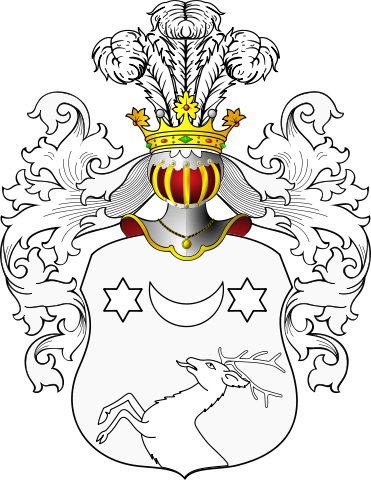

# THE POBŁOCKI COAT OF ARMS

**The Pobłocki coat of arms** (after [Wikipedia – Herb Pobłocki](https://pl.wikipedia.org/wiki/Pob%C5%82ocki)):

<cite>Image by Bastian, CC BY 3.0, https://commons.wikimedia.org/w/index.php?curid=14542711</cite>

* **Blazon:**

**Pobłocki Ig** (a variant of Brochwicz; Poblotzki): In the field, a demi-stag rampant, and above it a crescent between two stars in fess. Tinctures unknown. Crest: above the helmet, on a crown, three ostrich feathers. Mantling: of an unknown tincture.

* **Used by:**

Delk, Pobłocki.

* **Origin:**

This coat of arms is a modification of the Brochwicz arms.
