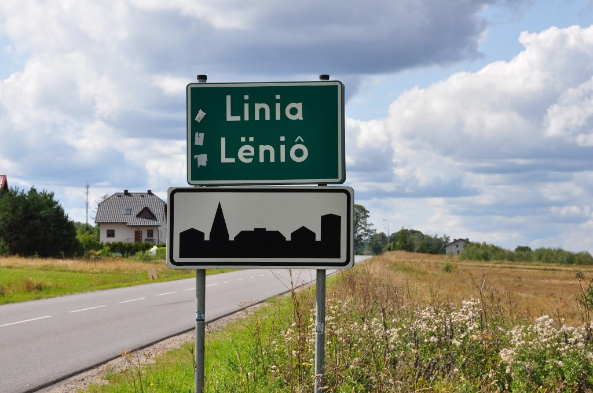
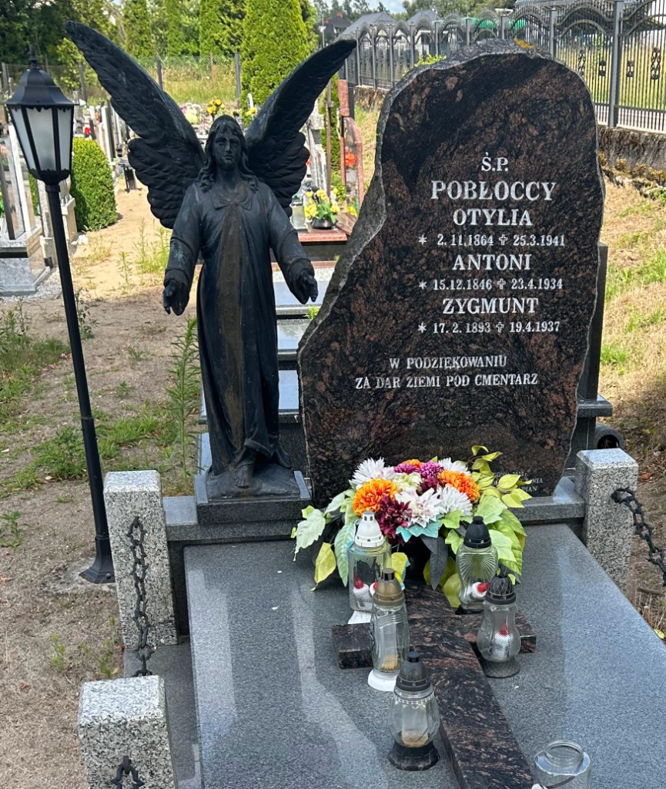
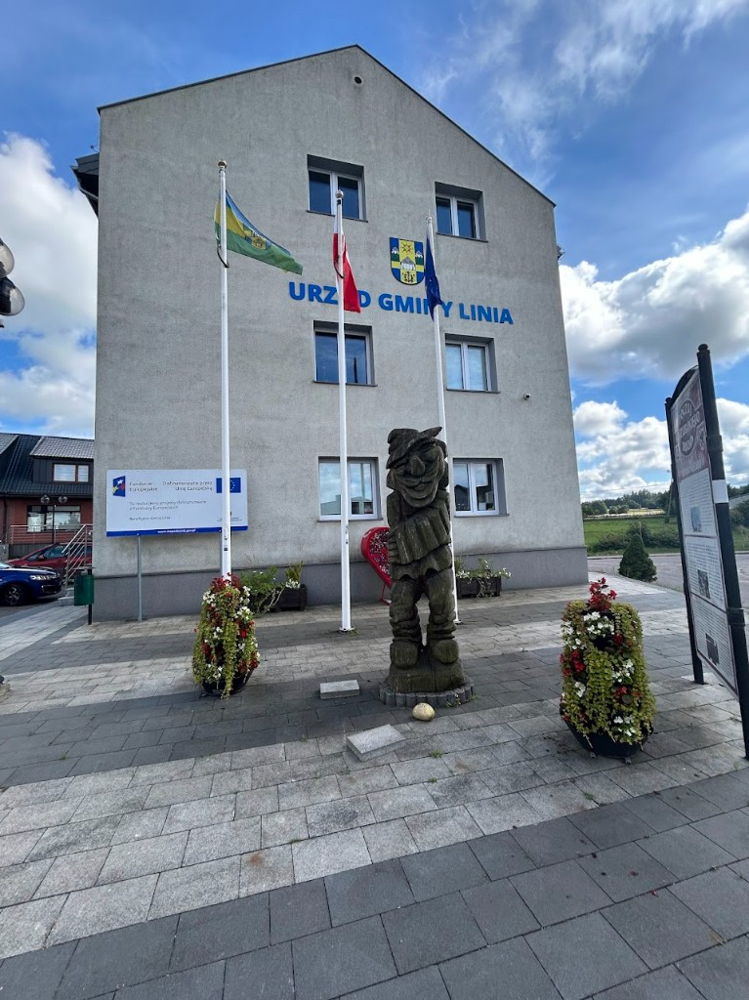

# **A SHORT ACCOUNT OF THE POBŁOCKI FAMILY**

<figure>
  
  <figcaption>Linia, in Kashubian Lëniô.</figcaption>
</figure>

**I.** In 1797 Wojciech (Albert) Delk Pobłocki bought a farm in Linia. He married a Zielezińska, and after her death he married Milczewska, his servant, who played the great lady, squandered the farm, and even had an ox unhitched from the yoke when she had a craving for beef. Delk is a byname of one branch of the Pobłockis of Pobłocie. By the late 18th century that blood was leaving the village: in the [1772–1773 tax cadastre](https://dipp.info.pl/baza-dipp/pomorskie/powiat-wejherowski/gmina-linia/dwor-poblocie) it appears there only through daughters.

**II.** Augustyn was married to Joanna Ernestyna Sychowska. The Chełmno gravestone calls her Ernestyna, and the [index of the Polish Biographical Dictionary](https://www.sejm-wielki.pl/s/surowe.php?o=psb.23288.1) calls her Joanna. She was a very capable manager and ran the farm in Linia with a sure hand, while her husband was a teacher in Łężyce, near Rumia. The sons’ birthplaces follow those two homes: Juliusz was born in Łężyce, Leon in Linia. They raised 5 sons, 4 of them priests, and 2 daughters. A plaque dedicated to the Pobłocki priests hangs in the vestibule at the entrance to the church in Linia.

1. Albert was the parish priest in Niedźwiedź.
2. [Gustaw](https://www.sejm-wielki.pl/b/psb.23286.1), *1840, †1915-11-25, a doctor of divinity, lexicographer, and writer. He was parish priest of [St Barbara in Kokoszkowy](https://parafiakokoszkowy.pl/duszpasterze/), between Fr Karol Latzke (until 1889) and Fr Wawrzyniec Insbrandt (from 1905). That is Kokoszkowy near Starogard, not Kokoszki in today’s Gdańsk. He published *Słowniczek kaszubski* (Poznań, 1875) and [*Słownik kaszubski z dodatkiem idyotyzmów chełmińskich i kociewskich*](https://rcin.org.pl/ijp/dlibra/publication/43401/edition/24816/content) (Chełmno, 1887).
3. [Leon](https://www.sejm-wielki.pl/b/psb.23288.1), *1856-09-11 in Linia, †1900-11-11 in Chełmno, where he is buried. A historian, teacher, and missionary. The family account calls him a monk and gives his birthday as 12 September.
4. [Juliusz](https://www.sejm-wielki.pl/b/psb.23287.1), *1835-11-29 in Łężyce near Rumia, †1915-02-09 in Chełmno. A doctor of divinity, dean, honorary canon, and parish priest of Chełmno from 1872 to 1915, and a teacher and social activist. During the Kulturkampf the Chełmno parish church, and he in particular, was a [mainstay of Polish life](https://repozytorium.ukw.edu.pl/bitstream/handle/item/7088/Dzwony%20che%C5%82mi%C5%84skie.%20Zarys%20dziej%C3%B3w.pdf). He wrote the memoir [*Na Kaszubach przed stu laty*](https://www.zawszepomorze.pl/artykul/204,ks-bp-konstantyn-dominik-ktory-zyl-w-opinii-swietosci). A transcription of the stone sometimes gives his death as 8 February.
5. Antoni, *1846-12-15, †1934-04-04, owner of Linia. Both dates are repeated on the gravestone in the parish cemetery at Linia.
6. Emilia died on †1907-10-30. Her birth is written two ways in the account: *1880-01-06 and *1884-01-06. Both are too late. Ernestyna, born in 1815, would have been about 65. The likely reading is *1860-01-06, when she was 44: a handwritten 6 is easily read as an 8. The same note lists daughters Maria (*1865-01-01, †1934-11-18) and Anna (*1870-05-04, †1983-06-03). Those births do not fit a mother born in 1860, and Anna would have lived to 113, so that part of the Chełmno inscription needs to be read on the stone. The account calls Tadeusz Czarnowski her son, director of the Regional Directorate of the State Railways in Gdańsk until 1939, with a private saloon car, and says he died in Jelenia Góra and his wife in Wrocław. The director of that name, [Tadeusz Czarnowski](https://pl.wikipedia.org/wiki/Tadeusz_Czarnowski) (*1872-08-22 in Łebno, †1950-12-27 in Wrocław), held the post from 1920 until 30 September 1929 and on 10 November 1909 married [Stefania née Prabucka](https://gdansk.gedanopedia.pl/gdansk/?title=CZARNOWSKI_TADEUSZ%2C_in%C5%BCynier%2C_patron_gda%C5%84skiej_ulicy). On these dates he is not Emilia’s son. He enters the family through the Prabuckis.
7. Matylda, born in September 1840, married Jan Prabucki, owner of Grabowiec in the parish of Bobowo, and is buried in the old cholera cemetery at Bobowo. Their son [Władysław](https://www.sejm-wielki.pl/b/sw.113360) (*1885-09-08 in Grabowiec, †1954-05-17, buried in Jawor) took over Nowa Wieś. Jan bought it on 14 November 1889 in Wąbrzeźno county and transferred it to his son on 23 March 1908. The family account places the estate in Golub county. The present village of [Nowawieś](https://pl.wikipedia.org/wiki/Nowawie%C5%9B_(wojew%C3%B3dztwo_kujawsko-pomorskie)) is in the gmina of Golub-Dobrzyń, about 5 km northeast of Golub. Around 1910 Władysław married Wanda Żelewska (*1884, †1935). The account says Wanda was the sister of Aniela, wife of Jan Woyke, owner of Łężyce, and that their daughter was Zofia née Woyke, wife of Zygmunt Pobłocki. An [interwar list of Pomeranian estates](http://ziemianie.pamiec.pl/pl/majatki/pm.html) names Jan Woyke at Łężyce. Władysław and Wanda’s son Witold (*1913 in Nowa Wieś, †1981) continued that line.

In the cemetery at Chełmno, in the first row from the top, is the grave of the Pobłocki family. Buried there are:

* Rev. Dr Juliusz Pobłocki, *1835-11-29 †1915-02-09, dean and parish priest of Chełmno,
* Antoni’s father, Augustyn, *1808-08-25 †1886-05-17,
* Antoni’s mother, Joanna Ernestyna née Sychowska, *1815-08-14 †1900-05-17,
* Antoni’s brother, Rev. Leon Pobłocki, *1856-09-11 †1900-11-11,
* Antoni’s sister, Emilia Czarnowska née Pobłocka, †1907-10-30.

**III.** Antoni and Otylia née Karszna, born in Potęgowo on *1864-11-02, died †1941-03-25. She was eighteen years younger than her husband and outlived their son Zygmunt: she died during the occupation. They raised 6 sons and 2 daughters.

1. Władysław and his wife Kazimiera (no children). After returning from America he joined the board of [“Gazeta Kaszubska” Drukarnia i Wydawnictwo S.A.](http://www.historiafabryk.pl/projekt/baza-spolek-akcyjnych/quot-gazeta-kaszubskaquot-drukarnia-i-wydawnictwo-s-a-w-wejherowie.html) in Wejherowo, registered on 5 September 1922. The paper ran until 1939. At its founding the largest shareholder was Ignacy Żylicz, and the other named board member was Józef Kokornaczyk. The family account also remembers Władysław as a sworn translator of English, French, German, Russian, and Latin. He lived and died in Wejherowo.
2. Dr Juliusz Pobłocki, *1888, and his wife Helena, raised 2 daughters and a son. In 1939 he was [vice-president of the regional court in Gdynia](https://www.skelnik.pl/sad-okregowy-w-gdyni/), not its president. From the company’s registration in 1922 he sat on its supervisory board. The register spells him “dr Juliusz Pabłocki”. During hearings he spoke Kashubian, and in the courtroom he took snuff and offered it to others.
3. Stanisław, *1890-02-14 in Linia, a doctor and a captain in the Polish Army. He died on †1942-01-11 as a prisoner of war, a physician in the camp hospital of Stalag XI C. He lies in an individual grave in the [war cemetery at Bergen-Lohheide](https://www.porta-polonica.de/en/war-graves/bergen-lohheide), beside the Bergen-Belsen camp, among the dead of a typhus epidemic. In 2012 a cross was set there with his name and that of Dr Roman Bilnik. The family account says he died in the concentration camp. His sons Zbigniew and Stanisław lived in Wejherowo after the war.
4. Zygmunt, *1893-02-17, †1937-04-19. He was killed in a car accident in Łężyce. The Linia gravestone gives the birth and the death. He was 44.
5. Wojciech was killed on the German–French front in †1916, as a German soldier.
6. Kazimierz, a second lieutenant of the Polish Army, fell †1920-08-15 near Warsaw.
7. Jadwiga married a Szukalski, of the Lipinki estate, Starogard Gdański county. During the war she took part in the resistance in Pomerania. She died in Wejherowo.
8. Apolonia married Andrzej Wawrzyniak in Brzusce, post office Subkowy.

**IV.** Zygmunt Pobłocki and Zofia née Woyke raised 3 sons and a daughter. Zygmunt was the wójt of Gmina Linia and a member of the county council in Wejherowo. In 1926, described as a farmer from Linia, he joined the county [National Defense Committee](https://jbc.bj.uj.edu.pl/Content/1001057/NDIGCZAS102892_1926_127.pdf). In 1930 he became president of the committee that founded the [volunteer fire brigade in Linia](https://remiza.pl/ochotnicza-straz-pozarna-w-linii/). He was widely known and well liked.

He was buried beside his father Antoni and his mother Otylia in the parish cemetery in Linia. He himself had given the land for the cemetery. The stone thanks the family for that gift of land, and the parish-history board in the church at Linia records a donation by the parishioner Zygmunt Pobłocki, after which the parishioners fenced the cemetery.

<figure>
  
  <figcaption>Otylia, Antoni, and Zygmunt Pobłocki in the parish cemetery at Linia. The inscription thanks them for the gift of land for the cemetery.</figcaption>
</figure>

Zofia kept the farm books and served as the civil registrar. After her husband’s death she managed the farm with the help of a steward. After the occupation of Poland in 1939, Polish farms in annexed Pomerania were placed under compulsory administration. From 28 February 1940 that administration was the [Ostdeutsche Landbewirtschaftungsgesellschaft](https://de.wikipedia.org/wiki/Ostdeutsche_Landbewirtschaftungsgesellschaft), known as Ostland. In 1942 it was renamed the Reichsgesellschaft für Landbewirtschaftung, or Reichsland. The family account remembered the name as “Ostern Deutsche Landbewirtschaftung”. Zofia and her family were turned out of the house, and their belongings were taken by the family of an SS man from Gdańsk who managed Polish farms. A shed on the estate was used during the war as a Gestapo lockup. It was demolished in 1975, when the volunteer fire brigade built its station. After the war, communist People’s Poland seized the farm again: the residence was converted into the municipal office, and the land was parceled out. The Pobłocki family had to leave the county and moved to Lower Silesia.

<figure>
  
  <figcaption>The municipal office of Gmina Linia. The Pobłocki house became the gmina office. The building that stands there now is its seat.</figcaption>
</figure>

The Linia estate covered 252 ha, of which about 40 ha were woodland, with meadows and other land. Besides the house, the buildings were a stable, a cowshed, a pigsty, a granary, and a barn. The farm also included 3 two-family houses, with small barns and cowsheds, for the workers. There were also 3 tenant houses (so-called *pustki*), with their farm buildings, 3 km from the farm. An [interwar list of landed estates](http://ziemianie.pamiec.pl/pl/majatki/pm.html) in the Pomeranian voivodeship names Zygmunt Pobłocki as the owner of Linia.

**V.** Of the children of Zygmunt and Zofia née Woyke, Bogusław is known, and his younger brother Janusz. The account says there were three sons and a daughter. The other son and the daughter are not named here.

Bogusław died in 2014. With his wife Zofia — a different Zofia from Zofia née Woyke — he lived in Szyszkowo, in Lower Silesia. They had four children, from oldest to youngest: Grzegorz, Michał, Cezary, and Anna. This paragraph comes from the family.

## Sources

* [Juliusz](https://www.sejm-wielki.pl/b/psb.23287.1), [Gustaw](https://www.sejm-wielki.pl/b/psb.23286.1), and [Leon](https://www.sejm-wielki.pl/b/psb.23288.1) Pobłocki in M.J. Minakowska’s genealogy, after *Polski Słownik Biograficzny*, vol. 27. Their mother’s name: [Leon’s source record](https://www.sejm-wielki.pl/s/surowe.php?o=psb.23288.1).
* [Władysław Prabucki](https://www.sejm-wielki.pl/b/sw.113360), with the family chronicle.
* [The Pobłocki arms](https://pl.wikipedia.org/wiki/Pob%C5%82ocki), after Przemysław Pragert.
* [The parish of St Barbara in Kokoszkowy](https://parafiakokoszkowy.pl/duszpasterze/).
* Gustaw Pobłocki’s [*Słownik kaszubski*](https://rcin.org.pl/ijp/dlibra/publication/43401/edition/24816/content).
* [Bergen-Lohheide](https://www.porta-polonica.de/en/war-graves/bergen-lohheide), Porta Polonica.
* [List of landed estates, Pomeranian voivodeship](http://ziemianie.pamiec.pl/pl/majatki/pm.html).
* [The volunteer fire brigade in Linia](https://remiza.pl/ochotnicza-straz-pozarna-w-linii/).
* [Tadeusz Czarnowski](https://pl.wikipedia.org/wiki/Tadeusz_Czarnowski) and the [Gdańsk Encyclopedia entry](https://gdansk.gedanopedia.pl/gdansk/?title=CZARNOWSKI_TADEUSZ%2C_in%C5%BCynier%2C_patron_gda%C5%84skiej_ulicy).
* [Ostdeutsche Landbewirtschaftungsgesellschaft](https://de.wikipedia.org/wiki/Ostdeutsche_Landbewirtschaftungsgesellschaft).
* [The manor at Pobłocie](https://dipp.info.pl/baza-dipp/pomorskie/powiat-wejherowski/gmina-linia/dwor-poblocie). The gravestone and the parish board at Linia are on this site.
