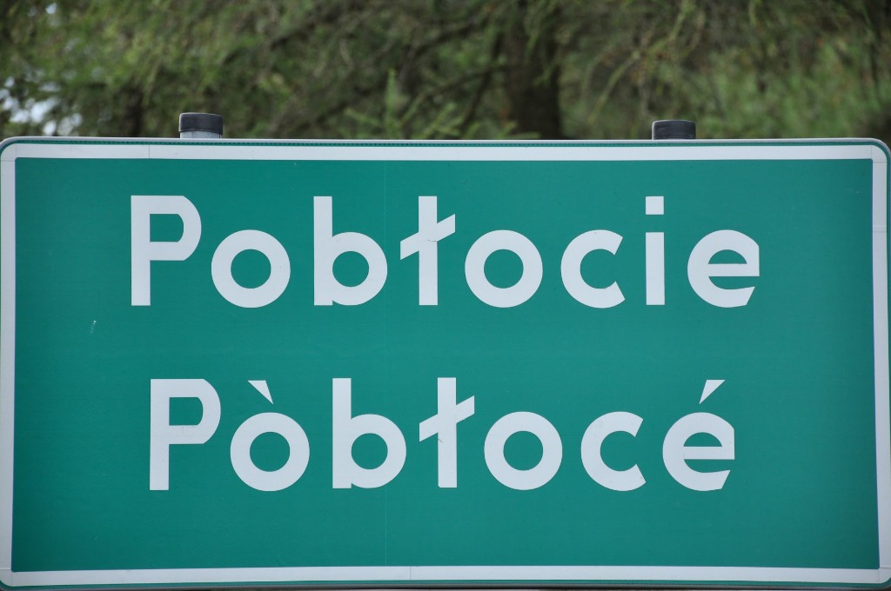

# POBŁOCIE

<figure>
  
  <figcaption>Pobłocie, in Kashubian Pòbłocé.</figcaption>
</figure>

Pobłocie is a small village, a sołectwo, in Gmina Linia, on the road between Strzepcz and Wejherowo. There are no historic monuments, and most of the houses along the road were built after the Second World War. This is not the Pobłocie near Kołobrzeg, called Pobloth in German and recorded as early as 1159.

The name comes from the village’s position relative to Strzepcz, formerly the local centre: “beyond the mud” (*po błocie*). The first record, given as “Poblocz”, is dated [1401](https://www.gminalinia.com.pl/gmina-linia/solectwa/solectwo-poblocie/) or [1400](https://dipp.info.pl/baza-dipp/pomorskie/powiat-wejherowski/gmina-linia/dwor-poblocie). In 1414 the sources note a court case of Wojciech Dobrogost of Pobłocie. The noble Pobłocki family, of the [Brochwicz arms](https://pl.wikipedia.org/wiki/Pob%C5%82ocki), comes from here. Some armorials describe the coat as a variant of Jeleń. The first men named in 1570 are Wojtek Poploczki and Matthias and Martinus Pobłocki. They used bynames: Bach, Delk (also Dalck and Dalek), Kisz, Kołdras, Kościanek, Mach, Siedwa, and Witek. Besides Pobłocie they held shares in other Kashubian villages, among them Gowino, Puzdrowo, Kętrzyno, Wyszecin, Lewino, Lewinko, Strzebielino, Mściszewice, Opalino, Podjazy, Tępcz, Żelewo, Dzięcielec, Łówcz, and Perlino. They held minor land offices in Mirachowo county and sat in the Sejm.

By about 1600 the estate was divided into eight shares. In the 1772/1773 contribution cadastre the village had four parts. Delk Pobłocki blood was already in the female line: one part belonged to Barbara Słuszewska, daughter of Barbara née Delk Pobłocka, and another, formally, to Katarzyna née Delk Pobłocka, wife of Jan Białk. In 1880 Pobłocie was still a knightly estate of eleven łans, held by the Żelewskis and a Wittke. The division among the peasants, and the change of the village into a gmina, belong to the second half of the 19th century. For a time the village itself was the seat of the gmina authorities. Pobłocie is still a farming village.
