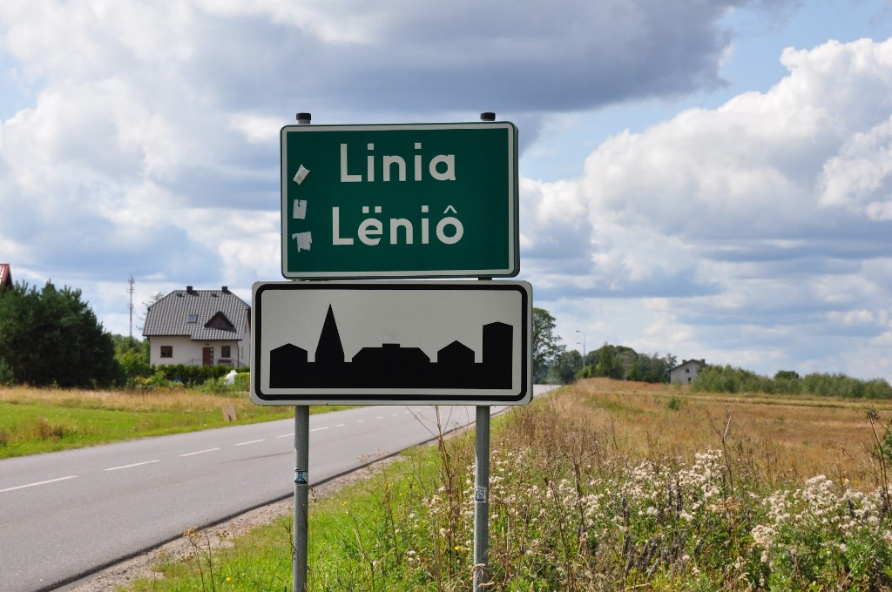

# **KRÓTKI OPIS RODU POBŁOCKICH**

**I.** W roku 1797 Wojciech (Albert) Delk Pobłocki kupił gospodarstwo w Linii, ożenił się z Zielezińską, a po jej śmierci poślubił Milczewską, swoją służącą, która udawała wielką panią, trwoniła gospodarstwo, nawet wołu kazała wyprzęgać z jarzma, gdy miała apetyt na wołowinę. Delk to przydomek jednej z gałęzi Pobłockich z Pobłocia. Pod koniec XVIII wieku ta krew wychodziła już ze wsi: w [katastrze z lat 1772–1773](https://dipp.info.pl/baza-dipp/pomorskie/powiat-wejherowski/gmina-linia/dwor-poblocie) występuje tam po kądzieli.

<figure>
  
  <figcaption>Linia, po kaszubsku Lëniô.</figcaption>
</figure>

**II.** Augustyn żonaty był z Joanną Ernestyną Sychowską. Była bardzo gospodarną kobietą i prowadziła wprawną ręką gospodarstwo w Linii, a mąż był nauczycielem w Łężycach koło Rumii. Stąd dwa miejsca urodzenia synów: Juliusz przyszedł na świat w Łężycach, Leon w Linii. Wychowali 5 synów, w tym 4 księży, i 2 córki. Tablica poświęcona księżom Pobłockim znajduje się w przedsionku przy wejściu do kościoła w Linii.

1. Albert (Wojciech) *1853-10-06 w Linii, †1923-10-17. Uczył się w gimnazjum wejherowskim i chełmińskim, studiował teologię w Münsterze i Innsbrucku, święcenia przyjął w 1878 roku, a doktorat zrobił w Rzymie w 1881. Do 1886 roku był wikariuszem brata Juliusza w Chełmnie, potem administratorem w Wabczu, a od 1896 proboszczem w Niedźwiedziu. W 1899 roku założył w Chełmnie Towarzystwo Wiecowe i wydał wizytację diecezji chełmińskiej biskupa Andrzeja Leszczyńskiego z 1647 roku.
2. [Gustaw](https://www.sejm-wielki.pl/b/psb.23286.1) *1840-09-21 w Łężycach, †1915-11-25 we Wtelnie, ksiądz doktor, leksykograf i literat. Proboszcz [parafii św. Barbary w Kokoszkowach](https://parafiakokoszkowy.pl/duszpasterze/), między ks. Karolem Latzkem (do 1889 roku) a ks. Wawrzyńcem Insbrandtem (od 1905). To Kokoszkowy koło Starogardu, nie dzisiejsze gdańskie Kokoszki. Od 1905 roku był proboszczem we Wtelnie pod Bydgoszczą i tam zmarł. Wydał *Słowniczek kaszubski* (Poznań, 1875) i [*Słownik kaszubski z dodatkiem idyotyzmów chełmińskich i kociewskich*](https://rcin.org.pl/ijp/dlibra/publication/43401/edition/24816/content) (Chełmno, 1887).
3. [Leon](https://www.sejm-wielki.pl/b/psb.23288.1) *1856-09-11 w Linii, †1900-11-11 w Chełmnie, gdzie jest pochowany. Historyk, pedagog i misjonarz. Był zmartwychwstańcem, z Rzymu pojechał na misję do Adrianopola, a po chorobie wstąpił do lazarystów w Krakowie.
4. [Juliusz](https://www.sejm-wielki.pl/b/psb.23287.1) *1835-11-29 w Łężycach pod Rumią, †1915-02-09 w Chełmnie, ksiądz doktor, dziekan chełmiński od 1888 roku, kanonik honorowy od 1904, proboszcz chełmiński w latach 1872–1915, nauczyciel i działacz społeczny. Studiował teologię w Pelplinie i w Münsterze. Napisał wspomnienia [*Na Kaszubach przed stu laty*](https://www.zawszepomorze.pl/artykul/204,ks-bp-konstantyn-dominik-ktory-zyl-w-opinii-swietosci).
5. Antoni *1846-12-15, †1934-04-04, właściciel Linii. Pochowany na cmentarzu parafialnym w Linii.
6. Emilia wyszła za mąż za Czarnowskiego i zmarła †1907-10-30. Ich synem był [Tadeusz Czarnowski](https://pl.wikipedia.org/wiki/Tadeusz_Czarnowski), dyrektor Dyrekcji Okręgowej Kolei Państwowych w Gdańsku do 1939 roku, z salonką do dyspozycji.
7. Matylda, urodzona we wrześniu 1840 roku, wyszła za Jana Prabuckiego, właściciela Grabowca w parafii Bobowo, i jest pochowana na starym cmentarzu cholerycznym w Bobowie. Ich syn [Władysław](https://www.sejm-wielki.pl/b/sw.113360) (*1885-09-08 w Grabowcu, †1954-05-17, pochowany w Jaworze) objął Nową Wieś w powiecie golubskim. Jan kupił ją 14 listopada 1889 roku i 23 marca 1908 przekazał synowi. Władysław ożenił się około 1910 roku z Wandą Żelewską (*1884, †1935). Wanda była siostrą Anieli, żony Jana Woyke, właściciela Łężyc, a ich córką była Zofia z Woyków, żona Zygmunta Pobłockiego. Syn Władysława i Wandy, Witold (*1913 w Nowej Wsi, †1981), przedłużył tę linię.

W Chełmnie na cmentarzu, w pierwszym rzędzie od góry, znajduje się grób rodziny Pobłockich:

* ks. dr Juliusz Pobłocki *1835-11-29 †1915-02-08, dziekan i proboszcz z Chełmna,
* ojciec Antoniego – Augustyn *1808-08-25 †1886-05-17,
* matka Antoniego – Ernestyna z Sychowskich *1815-08-14 †1900-05-17,
* brat Antoniego – ks. Leon Pobłocki, zakonnik *1856-09-12 †1900-11-14,
* siostra Antoniego – Emilia z Pobłockich Czarnowska *1884-01-06 †1907-10-30,
* córka Emilii Czarnowskiej – Anna *1870-05-04 †1983-06-03,
* oraz druga córka – Maria *1865-01-01 †1934-11-18.

**III.** Antoni i Otylia z domu Karszna, urodzona w Potęgowie *1864-11-02, zmarła †1941-03-25. Była o osiemnaście lat młodsza od męża i przeżyła syna Zygmunta: zmarła już w czasie okupacji. Wychowali 6 synów i 2 córki.

1. Władysław i żona Kazimiera (bezdzietni). Filolog i mierniczy. Po wieloletniej pracy w Ameryce wrócił i mieszkał w Wejherowie. W latach 1928–1939 był redaktorem „Gazety Kaszubskiej”. [Księga adresowa](http://kpbc.umk.pl/Content/215668) z około 1925 roku zapisuje go jako dziennikarza, Hallera 5. W tej samej księdze dr Juliusz jest sędzią przy Dworcowej 2. Władysław wszedł do zarządu spółki [„Gazeta Kaszubska” Drukarnia i Wydawnictwo S.A.](http://www.historiafabryk.pl/projekt/baza-spolek-akcyjnych/quot-gazeta-kaszubskaquot-drukarnia-i-wydawnictwo-s-a-w-wejherowie.html) w Wejherowie, zarejestrowanej 5 września 1922 roku. Gazeta wychodziła do 1939 roku. Największym akcjonariuszem przy założeniu był Ignacy Żylicz, a drugim członkiem zarządu Józef Kokornaczyk. Był także tłumaczem przysięgłym języka angielskiego, francuskiego, niemieckiego, rosyjskiego i łaciny. Mieszkał i zmarł w Wejherowie.
2. Dr Juliusz Pobłocki *1888, żona Helena: wychowali 2 córki i syna. W 1939 roku był [wiceprezesem Sądu Okręgowego w Gdyni](https://www.skelnik.pl/sad-okregowy-w-gdyni/). Od rejestracji spółki w 1922 roku zasiadał w jej radzie nadzorczej. Podczas rozpraw rozmawiał po kaszubsku, a na sali sądowej zażywał i częstował tabaką.
3. Stanisław *1890-02-14 w Linii, lekarz i kapitan Wojska Polskiego. Zmarł †1942-01-11 jako jeniec, lekarz szpitala obozowego Stalagu XI C. Leży w pojedynczym grobie na [cmentarzu wojennym w Bergen-Lohheide](https://www.porta-polonica.de/pl/wojenne/bergen-lohheide), przy obozie Bergen-Belsen, wśród ofiar epidemii tyfusu. W 2012 roku ustawiono tam krzyż z jego nazwiskiem i nazwiskiem dr. Romana Bilnika. Synowie Zbigniew i Stanisław po wojnie mieszkali w Wejherowie.
4. Zygmunt *1893-02-17, †1937-04-19. W wieku 44 lat zginął w wypadku samochodowym w Łężycach.
5. Wojciech zginął na froncie niemiecko-francuskim w †1916 roku jako żołnierz niemiecki.
6. Kazimierz, podporucznik WP, poległ †1920-08-15 pod Warszawą.
7. Jadwiga wyszła za Szukalskiego, majątek Lipinki, powiat Starogard Gdański. W czasie wojny działała w ruchu oporu na Pomorzu. Zmarła w Wejherowie.
8. Apolonia wyszła za mąż za Andrzeja Wawrzyniaka w Brzuscach, poczta Subkowy.

**IV.** Zygmunt Pobłocki i Zofia z domu Woyke wychowali 3 synów i córkę. Zygmunt był wójtem gminy Linia i należał do sejmiku powiatowego w Wejherowie. W 1926 roku, jako rolnik z Linii, wszedł do powiatowego [Komitetu Obrony Narodowej](https://jbc.bj.uj.edu.pl/Content/1001057/NDIGCZAS102892_1926_127.pdf). W 1930 roku został prezesem komitetu, który założył [Ochotniczą Straż Pożarną w Linii](https://remiza.pl/ochotnicza-straz-pozarna-w-linii/). Był człowiekiem ogólnie znanym i lubianym.

Pochowany został obok ojca Antoniego i matki Otylii na cmentarzu parafialnym w Linii. Ziemię pod cmentarz ofiarował sam. Nagrobek dziękuje za dar ziemi, a tablica z dziejami parafii w kościele w Linii zapisuje darowiznę parafianina Zygmunta Pobłockiego, po której parafianie ogrodzili cmentarz.

<figure>
  
  <figcaption>Otylia, Antoni i Zygmunt Pobłoccy na cmentarzu parafialnym w Linii. Napis dziękuje za dar ziemi pod cmentarz.</figcaption>
</figure>

Zofia prowadziła księgi gospodarskie i była urzędnikiem stanu cywilnego. Po śmierci męża zarządzała gospodarstwem przy pomocy rządcy. Po zajęciu Polski w 1939 roku polskie gospodarstwa na wcielonym Pomorzu objęła przymusowa administracja. Od 28 lutego 1940 roku prowadziła ją [Ostdeutsche Landbewirtschaftungsgesellschaft](https://de.wikipedia.org/wiki/Ostdeutsche_Landbewirtschaftungsgesellschaft), w skrócie Ostland. W 1942 roku przemianowano ją na Reichsgesellschaft für Landbewirtschaftung, czyli Reichsland. Zofię z rodziną wysiedlono z domu, a dobytek zabrała rodzina SS-mana z Gdańska, który zarządzał polskimi gospodarstwami. Szopa na terenie majątku służyła w czasie wojny jako areszt gestapo. Rozebrano ją w 1975 roku, gdy Ochotnicza Straż Pożarna budowała remizę. Po wojnie Polska Ludowa zajęła gospodarstwo ponownie: mieszkanie przebudowano na urząd gminy, a ziemie rozparcelowano. Rodzina Pobłockich musiała opuścić teren powiatu i przeniosła się na Dolny Śląsk.

<figure>
  
  <figcaption>Urząd Gminy Linia. Z domu Pobłockich zrobił się urząd gminy. Stojący dziś budynek jest jego siedzibą.</figcaption>
</figure>

Majątek Linia obejmował obszar 252 ha, w tym było około 40 ha lasów, łąki i inne. W skład budynków, oprócz domu mieszkalnego, wchodziły: stajnia, obora, chlewnia, magazyn zbożowy i stodoła. Do gospodarstwa należały również 3 domy dwurodzinne wraz ze stodółkami i obórkami dla pracowników. Poza tym własnością były jeszcze 3 domy dzierżawców (tzw. pustki) wraz z zabudowaniami gospodarczymi, położone 3 km od gospodarstwa.

**V.** Zygmunt i Zofia z Woyków wychowali trzech synów i córkę. Z synów znamy Bogusława i jego młodszego brata Janusza.

Bogusław zmarł w 2014 roku. Z żoną Zofią, inną niż Zofia z Woyków, mieszkał w Szyszkowie na Dolnym Śląsku. Mieli czworo dzieci, od najstarszego: Grzegorza, Michała, Cezarego i Annę.

## Źródła

* [Juliusz](https://www.sejm-wielki.pl/b/psb.23287.1), [Gustaw](https://www.sejm-wielki.pl/b/psb.23286.1) i [Leon](https://www.sejm-wielki.pl/b/psb.23288.1) Pobłoccy w genealogii M.J. Minakowskiej, za Polskim Słownikiem Biograficznym, t. 27. Imię matki: [zapis źródłowy Leona](https://www.sejm-wielki.pl/s/surowe.php?o=psb.23288.1).
* [Władysław Prabucki](https://www.sejm-wielki.pl/b/sw.113360), z kroniką rodzinną.
* [Herb Pobłocki](https://pl.wikipedia.org/wiki/Pob%C5%82ocki), za Przemysławem Pragertem.
* [Parafia św. Barbary w Kokoszkowach](https://parafiakokoszkowy.pl/duszpasterze/).
* [*Słownik kaszubski*](https://rcin.org.pl/ijp/dlibra/publication/43401/edition/24816/content) Gustawa Pobłockiego.
* [Bergen-Lohheide](https://www.porta-polonica.de/pl/wojenne/bergen-lohheide), Porta Polonica.
* [Spis majątków ziemskich, woj. pomorskie](http://ziemianie.pamiec.pl/pl/majatki/pm.html).
* [Ochotnicza Straż Pożarna w Linii](https://remiza.pl/ochotnicza-straz-pozarna-w-linii/).
* [Ostdeutsche Landbewirtschaftungsgesellschaft](https://de.wikipedia.org/wiki/Ostdeutsche_Landbewirtschaftungsgesellschaft).
* [Dwór w Pobłociu](https://dipp.info.pl/baza-dipp/pomorskie/powiat-wejherowski/gmina-linia/dwor-poblocie). Nagrobek i tablica parafialna w Linii są na tej stronie.
* Józef Borzyszkowski, szkic o Gustawie i Juliuszu, w: *Zasłużeni ludzie Pomorza Nadwiślańskiego z okresu zaboru pruskiego*, Gdańskie Towarzystwo Naukowe, Pomorze Gdańskie nr 12, Gdańsk 1979. Matrykuły Akademii w Münsterze zestawił Fritz von Poblotzki, Münster 2003.
