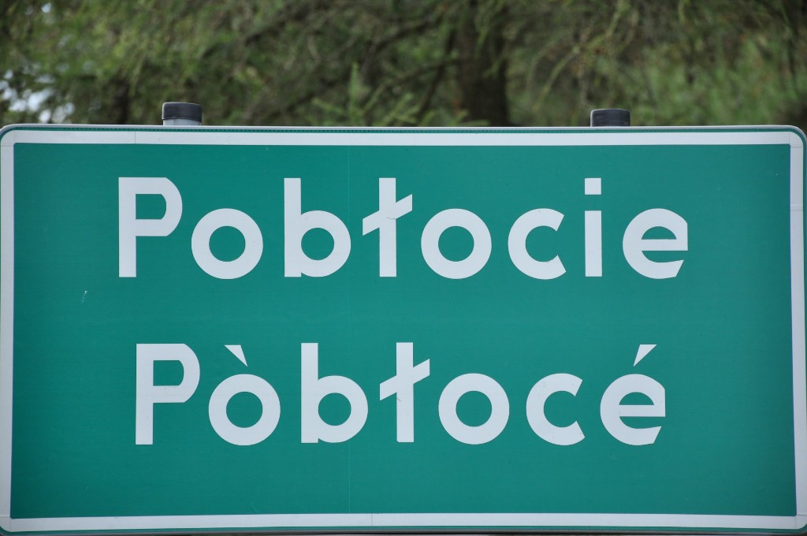

# POBŁOCIE

<figure>
  
  <figcaption>Pobłocie, po kaszubsku Pòbłocé.</figcaption>
</figure>

Pobłocie to nieduża wieś sołecka w gminie Linia, przy drodze łączącej Strzepcz z Wejherowem. Nie ma tu zabytków, a większość domów wzdłuż szosy powstała po ostatniej wojnie. To inne Pobłocie niż wsie pod Kołobrzegiem, po niemiecku Pobloth, notowane już w 1159 roku.

Nazwa pochodzi od położenia wobec dawniej stołecznego Strzepcza: „po błocie”. Pierwsza wzmianka, w formie „Poblocz”, bywa datowana na [1401](https://www.gminalinia.com.pl/gmina-linia/solectwa/solectwo-poblocie/) albo [1400](https://dipp.info.pl/baza-dipp/pomorskie/powiat-wejherowski/gmina-linia/dwor-poblocie) rok. W 1414 roku źródła notują sprawę sądową Wojciecha Dobrogosta z Pobłocia. Stąd wywodzi się rodzina szlachecka Pobłockich [herbu Brochwicz](https://pl.wikipedia.org/wiki/Pob%C5%82ocki), w części herbarzy opisywanego jako odmiana Jelenia. Pierwsi wymienieni z nazwiska, w 1570 roku, to Wojtek Poploczki oraz Matthias i Martinus Pobłocki. Używali przydomków: Bach, Delk (także Dalck i Dalek), Kisz, Kołdras, Kościanek, Mach, Siedwa i Witek. Oprócz Pobłocia mieli działy w innych wsiach kaszubskich, między innymi w Gowinie, Puzdrowie, Kętrzynie, Wyszecinie, Lewinie, Lewinku, Strzebielinie, Mściszewicach, Opalinie, Podjazach, Tępczu, Żelewie, Dzięcielcu, Łówczu i Perlinie. Pełnili lokalne urzędy ziemskie w powiecie mirachowskim i posłowali na sejm.

Około 1600 roku dobra były podzielone na osiem działów. W katastrze kontrybucyjnym z 1772/1773 roku wieś składała się z czterech części. Krew Delków Pobłockich szła już wtedy po kądzieli: jedna część należała do Barbary Słuszewskiej, córki Barbary z Delków Pobłockich, inna formalnie do Katarzyny z Delków Pobłockich, żony Jana Białka. W 1880 roku Pobłocie było jeszcze majątkiem rycerskim o powierzchni jedenastu łanów, w rękach Żelewskich i Wittkego. Rozparcelowanie między chłopów i zmiana wsi w gminę przypadają na drugą połowę XIX wieku. Przez pewien czas wieś była siedzibą władz gminnych. Do dziś ma charakter rolniczy.
